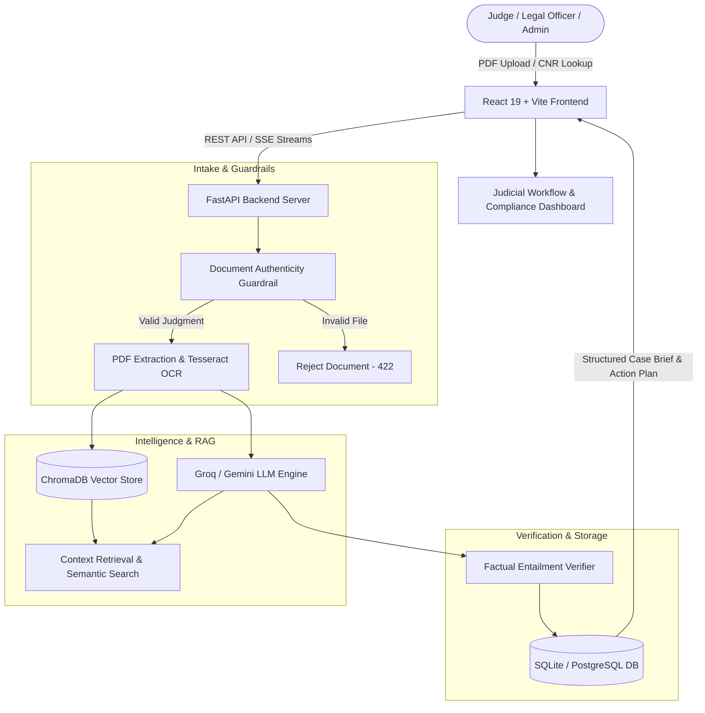

# ⚖️ COATS — Court Order Action & Tracking System

[](https://opensource.org/licenses/MIT)
[](https://fastapi.tiangolo.com)
[](https://react.dev)
[](https://vitejs.dev)
[](https://groq.com)
[](https://www.trychroma.com)

**COATS (Court Order Action & Tracking System)** is an enterprise-grade judicial intelligence and compliance platform designed for Indian courts, legal reviewers, and administrative government departments. 

It bridges the gap between judicial pronouncements and executive execution by transforming unstructured multi-page court orders and judgments into **source-verified, structured action plans with traceable deadlines and responsible authorities**.

---

## 📌 Table of Contents
- [The Problem COATS Solves](#-the-problem-coats-solves)
- [Key Features](#-key-features)
- [System Architecture](#-system-architecture)
- [Technologies Used](#-technologies-used)
- [Project Directory Structure](#-project-directory-structure)
- [Role-Based Access Control (RBAC)](#-role-based-access-control-rbac)
- [Getting Started](#-getting-started)
  - [Prerequisites](#prerequisites)
  - [Backend Setup (FastAPI)](#backend-setup-fastapi)
  - [Frontend Setup (React + Vite)](#frontend-setup-react--vite)
- [API Endpoints Overview](#-api-endpoints-overview)
- [Security & Grounding Guardrails](#-security--grounding-guardrails)
- [License](#-license)

---

## 🎯 The Problem COATS Solves
In Indian administrative and legal operations, thousands of court judgments and interim directions are issued daily as lengthy PDFs (often containing complex legal language, historical precedents, and multi-party arguments). 

Government departments and judicial clerks frequently struggle to:
1. Quickly identify the **exact operative directions** amidst pages of arguments.
2. Map **compliance deadlines** and avoid contempt proceedings.
3. Assign **responsible departmental desks/officers** to specific mandates.
4. Ensure **factual fidelity** without LLM hallucinations.

**COATS** automates the entire intake-to-compliance lifecycle with strict source attribution, ground-truth verification, and role-based tracking.

---

## 🚀 Key Features

- **Automated Judgment Intake & eCourts Integration:**
  - Upload digital or scanned PDF judgments directly.
  - Query official case records and orders via Indian judicial **CNR (Case Number Record)** lookup.
- **Document Authenticity Guardrail:**
  - Microsecond heuristic intake filter that checks judicial forum markers, bench coram, and case filings, blocking invalid files (e.g., invoices, resumes) before processing.
- **AI-Powered Structured Extraction:**
  - Automatically identifies Case Title, Docket Number, Court/Bench, Hon'ble Judges, Filing Dates, and Disposed/Admitted status.
  - Extracts distinct **Relief Items** with granular outcomes (Granted, Dismissed, Directed).
  - Determines statutory **financial exposure** and immediate administrative impact.
- **Operative Compliance Action Plans:**
  - Converts court directions into step-by-step required workflows.
  - Automatically maps each action to nearest statutory deadlines (e.g., "within 21 days").
- **100% Source-Grounded Citations & Entailment:**
  - Every workflow step and extracted claim cites the exact **page number** and **paragraph extract** from the original judgment.
  - Real-time entailment validation to audit AI claims against source text.
- **Source-Bound Legal Q&A (RAG):**
  - High-speed semantic search over indexed judgment text using **ChromaDB**.
  - Natural language Q&A providing verifiable excerpts and confidence scores.
- **Real-Time Streaming Pipeline:**
  - Server-Sent Events (SSE) stream live pipeline stages (PDF Extraction → Vector Indexing → AI Synthesis → Guardrail Verification) directly to the user interface.

---

## 🏛️ System Architecture



---

## 💻 Technologies Used

### **Frontend**
| Technology | Description |
|---|---|
| **React 19** | Modern reactive component architecture with hooks |
| **Vite** | Blazing-fast frontend bundler and HMR dev environment |
| **Custom Judicial Design System** | Sovereign judicial dark theme with gold accents, crisp legal typography, and accessible status indicators |
| **Server-Sent Events (SSE)** | Real-time analysis streaming without WebSocket overhead |

### **Backend & Core Engine**
| Technology | Description |
|---|---|
| **Python 3.11+** | Core runtime environment |
| **FastAPI** | High-performance asynchronous web framework |
| **Uvicorn** | Lightning-fast ASGI production web server |
| **Pydantic v2** | Data schema validation and structured JSON serialization |
| **HTTPX** | Asynchronous HTTP client for eCourts portal synchronization |

### **AI, LLM & Orchestration**
| Technology | Description |
|---|---|
| **Groq Cloud API** | Ultra-low latency LPU inference engine |
| **Google Gemini (ADK)** | Multi-modal reasoning and fallback language models |
| **LangChain & LangChain-Groq** | Orchestration for structured prompt pipelines and RAG chains |

### **Document Processing & OCR**
| Technology | Description |
|---|---|
| **pdfplumber** | Precise character and layout parsing for digital legal orders |
| **pypdf** | Robust PDF document stream and metadata extractor |
| **Tesseract OCR (`pytesseract`)** | Optical character recognition fallback for scanned court orders |
| **Poppler** | High-fidelity PDF rendering engine |

### **Vector Database & Persistence**
| Technology | Description |
|---|---|
| **ChromaDB** | Local, embedded vector database for semantic search and paragraph embeddings |
| **SQLAlchemy** | SQL toolkit and Object Relational Mapper (ORM) |
| **SQLite / PostgreSQL** | Relational storage for user accounts, case records, audit logs, and compliance states |
| **Celery + Redis** | Optional distributed task queue for large-scale enterprise deployments |

---

## 📂 Project Directory Structure

```
AI-Bharat/
├── README.md                                  # Root documentation & architecture guide
├── .gitignore                                 # Git rules for secrets, DBs, and environments
│
├── judgment-platform/                         # Frontend Application (React 19 + Vite)
│   ├── index.html                             # Single page application entry
│   ├── package.json                           # Frontend scripts and dependencies
│   ├── vite.config.js                         # Vite build configuration
│   ├── public/                                # Static assets
│   └── src/
│       ├── App.jsx                            # Root application view & role router
│       ├── api/
│       │   └── judgmentAI.js                  # Frontend API client & SSE event listeners
│       └── components/
│           ├── UploadScreen.jsx               # File ingestion & CNR lookup modal
│           ├── WorkflowScreen.jsx             # Comprehensive case brief, action plan & Q&A
│           ├── CasesScreen.jsx                # Judge case docket and status management
│           ├── DashboardScreen.jsx            # Admin compliance telemetry & analytics
│           └── LoginScreen.jsx                # Multi-role authentication & registration
│
└── judgment-platform/judgment-ai-backend/     # Backend Application (FastAPI)
    └── judgment-ai/
        ├── main.py                            # FastAPI application entry point
        ├── requirements.txt                   # Python backend dependencies
        ├── database.py                        # SQLAlchemy database engine & sessions
        ├── config.py                          # Environment settings & configuration
        ├── .env.example                       # Template for environment secrets
        ├── models/
        │   ├── schemas.py                     # Pydantic validation models
        │   └── db_models.py                   # SQLAlchemy ORM models
        ├── routers/
        │   ├── upload.py                      # /upload endpoint (PDF processing)
        │   ├── ecourts.py                     # /ecourts endpoint (CNR lookup)
        │   ├── cases.py                       # Case brief retrieval & /ask Q&A
        │   ├── dashboard.py                   # Compliance metrics & statistics
        │   ├── stream.py                      # SSE live pipeline stream
        │   └── auth.py                        # User login, registration & token management
        └── services/
            ├── ai_service.py                  # LLM inference & structured extraction
            ├── vector_service.py              # ChromaDB vector embedding & retrieval
            ├── pdf_service.py                 # PDF parsing & OCR extraction
            ├── nemo_guardrail_service.py      # Input document authenticity verification
            └── guardrail_service.py           # Output factual entailment verification
```

---

## 👥 Role-Based Access Control (RBAC)

COATS provides four tailored views based on administrative responsibilities:

| Role | Portal Access | Permissions |
|---|---|---|
| **Judge / Legal Reviewer** (`legal_reviewer`) | Docket View, Case Briefs, RAG Q&A | Review orders, inspect citations, approve operative compliance plans |
| **Department Officer** (`department_officer`) | Assigned Cases, Action Items | View designated compliance directives, mark milestones, submit proofs |
| **Decision Maker / HOD** (`decision_maker`) | Departmental Overviews, High-Level Briefs | Review financial liabilities, monitor risks, authorize executive decisions |
| **System Administrator** (`admin`) | System Dashboard, Platform Telemetry | Monitor active dockets, compliance velocity, and system health metrics |

---

## 🛠️ Getting Started

### Prerequisites
- **Node.js**: v18+ and `npm`
- **Python**: v3.11+
- *(Optional for OCR)*: [Tesseract-OCR](https://github.com/tesseract-ocr/tesseract) and [Poppler](https://poppler.freedesktop.org/)

---

### Backend Setup (FastAPI)

1. Navigate to the backend directory:
   ```bash
   cd "judgment-platform/judgment-ai-backend/judgment-ai"
   ```

2. Create and activate a Python virtual environment:
   ```bash
   # Windows PowerShell:
   python -m venv .venv
   .\.venv\Scripts\Activate.ps1

   # Linux / macOS:
   python3 -m venv .venv
   source .venv/bin/activate
   ```

3. Install required packages:
   ```bash
   pip install -r requirements.txt
   ```

4. Configure your `.env` file:
   ```bash
   cp .env.example .env
   ```
   Add your API keys inside `.env`:
   ```ini
   GROQ_API_KEY=gsk_your_groq_api_key_here
   GOOGLE_API_KEY=your_google_gemini_api_key_here
   GOOGLE_ADK_MODEL=gemini-2.0-flash-lite
   OCR_ENABLED=true
   ALLOWED_ORIGINS=*
   ```

5. Start the backend server:
   ```bash
   uvicorn main:app --reload --port 8000
   ```
   *Interactive API docs available at: `http://localhost:8000/docs`*

---

### Frontend Setup (React + Vite)

1. Open a new terminal in the `judgment-platform` directory:
   ```bash
   cd "judgment-platform"
   ```

2. Install dependencies:
   ```bash
   npm install
   ```

3. Launch the development server:
   ```bash
   npm run dev
   ```
   *Frontend UI accessible at: `http://localhost:5173`*

---

## 📡 API Endpoints Overview

| Method | Endpoint | Description |
|---|---|---|
| `POST` | `/upload` | Upload PDF judgment, extract text, and initiate indexing |
| `POST` | `/ecourts/fetch-by-cnr` | Ingest case judgment directly using 16-character CNR number |
| `GET` | `/stream/{case_id}` | Live Server-Sent Events (SSE) of processing stages |
| `GET` | `/cases/{case_id}/brief` | Retrieve structured brief, metrics, relief items & action plan |
| `POST` | `/cases/{case_id}/ask` | Source-bound legal question answering with page citations |
| `GET` | `/cases` | List docket cases accessible to the authenticated role |
| `GET` | `/dashboard/metrics` | Retrieve administrative compliance rates and deadline alerts |
| `POST` | `/auth/login` | Authenticate user credentials and return JWT session |
| `POST` | `/auth/signup` | Register new judicial officer or administrator |
| `GET` | `/health` | Server health check and active service status |

---

## 🛡️ Security & Grounding Guardrails

1. **Input Authenticity Shield:**
   - Detects negative markers (resumes, invoices, receipts) and validates required judicial hallmarks (Court benches, Petitioners, Case Numbers, and operative phrases like `ordered`, `directed`, `disposed of`).
2. **Hallucination Prevention (Factual Entailment):**
   - Filters AI-generated action steps through a factual entailment middleware, scoring claims against the source PDF text before rendering in the client dashboard.
3. **Data Privacy & Local Deployment:**
   - Case data, vectors, and dockets can be deployed completely within private infrastructure or government on-premise servers.

---

## 📄 License
This project is licensed under the [MIT License](LICENSE).
